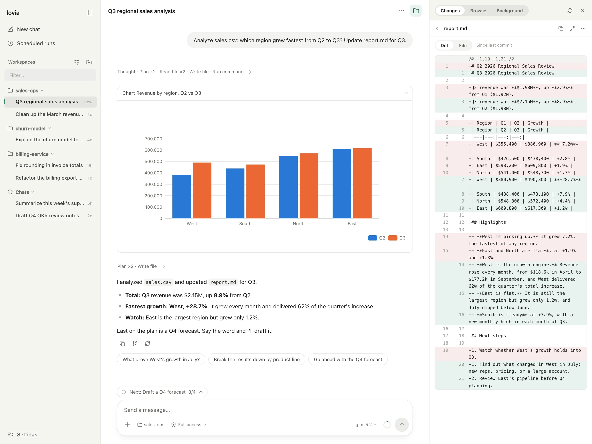

# lovia

[English](https://github.com/cymoo/lovia/blob/main/README.md) | **简体中文**

lovia 是一个轻量、不绑定模型厂商的 Python Agent 框架，有三种用法：

| | 你得到什么 | 从这里开始 |
| --- | --- | --- |
| [**作为库**](#作为库) | 一个 Agent 循环：工具、流式输出、会话、审批、上下文管理，写的都是普通 Python | `pip install lovia` |
| [**作为开箱即用的 harness**](#作为开箱即用的-harnesslovia-web) | 一个本地聊天应用，直接在你的目录里干活：文件、shell、记忆、skills、MCP、定时任务 | `pip install "lovia[web]"`，然后 `lovia web` |
| [**作为自定义 harness 的底座**](#作为自定义-harness-的底座) | 把这个应用当作工具箱：加上你的工具、换上你的品牌、加自己的视图，或者只用它的 API | `pip install "lovia[web]"`，然后 `default_app()` 或 `create_app()` |

每一层都建在前一层之上：从一个脚本走到一个产品，不用换框架。

<picture>
  <source media="(prefers-color-scheme: dark)" srcset="https://raw.githubusercontent.com/cymoo/lovia/main/docs/images/web-ui-dark.webp">
  
</picture>

## 作为库

```bash
pip install lovia
export OPENAI_BASE_URL=https://your-endpoint/v1  # 任何 OpenAI 兼容端点
export OPENAI_API_KEY=...
```

```python
from lovia import Agent, tool


@tool
def get_order(order_id: str) -> str:
    """根据订单号查询订单状态。"""
    return f"订单 {order_id}：两天前已发货，预计周四送达。"


agent = Agent(
    name="support",
    instructions="回答前先查询订单，用一两句话回复。",
    model="glm-5.2",  # 你的端点提供的模型
    tools=[get_order],
)

print(agent.run_sync("我的订单 A-1042 到哪了？").output)
```

`run_sync()` 适合脚本和 notebook；异步代码里用 `await Runner.run(agent, ...)`，
需要类型化事件流就用 `Runner.stream(...)`。使用 Anthropic 时，设置 `ANTHROPIC_API_KEY`
并写 `model="anthropic:<model>"`；更多见[配置模型](https://cymoo.github.io/lovia/zh/quickstart/#2-配置模型)。

核心只依赖 `httpx`、`pydantic` 和 `pyyaml`。在循环之上：

- **工具**来自带类型的函数，并发执行；结构化输出直接解析成 Pydantic 模型。
- **多 Agent**：handoff、agent-as-tool 或后台子 Agent。
- **审批**：敏感工具的调用可以由任意 UI 决定，也可以挂起等人回来再答。
- **Session 与 Checkpoint**：对话持久化，崩溃的运行可以续跑。
- **上下文压缩**：从不改写 transcript，保持 provider 的提示词缓存持续命中。
- **工作区**：文件和 shell 工具由同一套路径与命令策略管理，可以在本地，也可以在 SSH
  主机或容器里。
- **插件**：Skills、MCP、Todo 和长期记忆，与你自己的扩展走同一套机制。
- **护栏、重试、预算、取消与运行中引导**，以及离线的 `ScriptedProvider` 和评测。

**→ [速查表](https://cymoo.github.io/lovia/zh/cheatsheet/)**：每个功能一段代码。
然后是[快速开始](https://cymoo.github.io/lovia/zh/quickstart/)和
[核心概念](https://cymoo.github.io/lovia/zh/concepts/)。

## 作为开箱即用的 harness：`lovia web`

```bash
pip install "lovia[web]"
lovia web
```

打开 `http://127.0.0.1:8000`，首次启动时添加一个模型。新对话在启动目录里工作
（`lovia web ~/code/app` 指定其他目录）。

- **在你的目录里干活的助手**：读写文件、执行命令、用 todo 清单规划、搜索网页，
  把独立的工作交给后台子 Agent。可以同时在多个项目里工作：侧栏按工作区分组对话，
  每个对话单独选目录、模型和权限模式（从只读到完全访问）。SSH 主机或容器里的目录也可以。
- **遵循项目自己的约定**：对话会读取所在目录的 `AGENTS.md`、`.agents/skills` 和
  `.mcp.json`。输入框里 `/` 列出命令和 skills，`@` 引用文件。
- **完整的聊天体验**：流式输出、审批、从任一回复分支、运行中插话、附件、定时任务，
  以及可编辑的长期记忆。关掉标签页，运行也会继续。
- **设置不用重启**：模型、MCP 服务器、skills 和助手的指令都在设置页里改。所有数据都在一个
  home 目录里（`~/.lovia`，`--home` 可指定其他目录），从不放进你的仓库。

在 `127.0.0.1` 上无需认证；绑定其他地址时必须使用 token。完整参数见 `lovia web --help`。

**→ [Web UI 指南](https://cymoo.github.io/lovia/zh/web-ui/)**

## 作为自定义 harness 的底座

`lovia web` 由一组公开的部件组装而成，你也可以直接用它们，按三种深度使用。

**同一个助手，加上你的东西。** `default_app()` 构建的正是 `lovia web` 启动的应用；
`customize` 把每个 Agent 交给你扩展：

```python
from lovia import tool
from lovia.web import default_app, serve


@tool
def order_status(order_id: str) -> str:
    """查询订单。"""
    return "shipped"


serve(default_app(customize=lambda agent: agent.clone(tools=[*agent.tools, order_status])))
```

**你的 Agent，你的页面。** `create_app(agent)` 原样托管你构建的 Agent，并返回一个
FastAPI 应用，方便挂上你自己的路由：

```python
from lovia.web import ChatUI, create_app, serve

app = create_app(
    agent,
    title="Acme",
    auth=my_auth,          # 任意 FastAPI 依赖
    run_deps=my_run_deps,  # 谁在提问、页面上选了什么 -> ctx.deps
    ui=ChatUI(assets="ui", styles=["theme.css"], logo="logo.svg", scripts=["acme.js"]),
)
serve(app)
```

- **能渲染 UI 的工具结果**：工具返回 `ui_result(kind, props)` 即可；内置表格、ECharts
  图表和沙箱 HTML 页面。
- **可脚本化的页面**：通过 `window.lovia` 注册自定义 kind 的渲染器、工具卡片视图、斜杠命令，
  以及聊天旁边的整页视图；模板 block、设计 token 和 `data-i18n` 键分别用来改结构、外观和
  文案。`lovia web init-ui ui` 生成脚手架目录；[lovia-react](https://github.com/cymoo/lovia-react)
  演示了用 React 视图扩展内置聊天页面。

**只要 API。** 页面能做的一切都是 JSON + SSE API（`/api/docs`）：`create_app(agent, ui=False)`
只提供 API，`build_api_router()` 把它挂进你自己的 FastAPI 应用，认证由你自己负责。

**→ [Web 服务端指南](https://cymoo.github.io/lovia/zh/web-server/)** ·
[HTTP API](https://cymoo.github.io/lovia/zh/http-api/) ·
[生产部署](https://cymoo.github.io/lovia/zh/deployment/)

## 设计取向

- **核心很小。** 只有三个硬依赖；MCP、Web 应用和搜索后端都是可选的 extra。
- **抽象很少。** 不可变的 `Agent`、无状态的 `Runner`、`@tool`，以及作为唯一扩展轴的插件。
  扩展点都是 dataclass、Protocol 和装饰器，从不靠继承。
- **一条路径读到底。** 模型调用、工具执行、重试和持久化都在一个显式的循环里；
  遇到意外行为，顺着一条链查下去就行。
- **克制。** 能在应用层用几行代码搞定的，就不做进框架。

## 示例、安装与开发

[示例](https://github.com/cymoo/lovia/tree/main/examples)是一条按编号排列、可直接运行的
学习路径：从 `01_hello.py` 到带组件、品牌定制和扩展脚本的 Web 应用（`26`–`27`、`31`–`35`）。

| 需求 | 安装 |
| --- | --- |
| 核心库 | `pip install lovia` |
| MCP | `pip install "lovia[mcp]"` |
| Web 应用（含 MCP） | `pip install "lovia[web]"` |
| DuckDuckGo 搜索 | `pip install "lovia[ddg]"`（Tavily 无需额外依赖，设置 `TAVILY_API_KEY` 即可） |
| 可运行示例 | `pip install "lovia[examples,web]"` |

```bash
python -m venv .venv && .venv/bin/pip install -e ".[dev]"
.venv/bin/python -m pytest
.venv/bin/python -m ruff check . && .venv/bin/python -m ruff format .
.venv/bin/python -m mypy lovia
```

真实端点测试默认跳过，开启方式：
`LOVIA_LIVE_TESTS=1 .venv/bin/python -m pytest -m live_provider`。1.0 之前哪些部分可能变化，
见[稳定性](https://cymoo.github.io/lovia/zh/stability/)；贡献者请先读
[架构说明](https://cymoo.github.io/lovia/zh/architecture/)。
