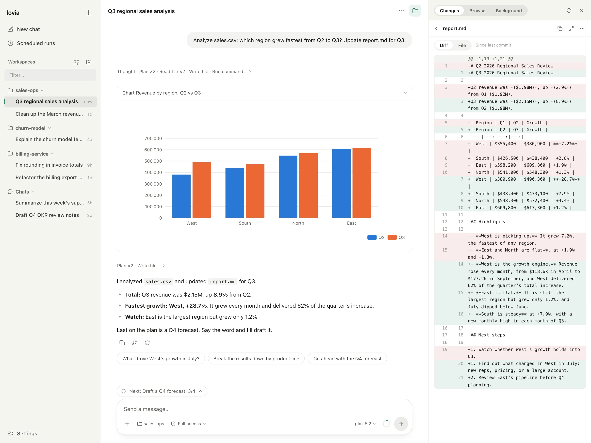

# lovia

**English** | [简体中文](https://github.com/cymoo/lovia/blob/main/README-zh.md)

lovia is a lightweight, provider-neutral agent framework for Python. Use it
three ways:

| | You get | Start with |
| --- | --- | --- |
| [**A library**](https://github.com/cymoo/lovia#a-library) | An agent loop with tools, streaming, sessions, approvals and context management, in ordinary Python | `pip install lovia` |
| [**A ready-made harness**](https://github.com/cymoo/lovia#a-ready-made-harness-lovia-web) | A local chat app that works in your folders: files, shell, memory, skills, MCP, schedules | `pip install "lovia[web]"`, then `lovia web` |
| [**The base for your own**](https://github.com/cymoo/lovia#the-base-for-your-own-harness) | That app as a toolkit: add your tools, brand the page, add views — or keep only its API | `pip install "lovia[web]"`, then `default_app()` or `create_app()` |

Each layer is built on the one before it, so moving from a script to a
product never means switching frameworks.

<picture>
  <source media="(prefers-color-scheme: dark)" srcset="https://raw.githubusercontent.com/cymoo/lovia/main/docs/images/web-ui-dark.webp">
  
</picture>

## A library

```bash
pip install lovia
export OPENAI_BASE_URL=https://your-endpoint/v1  # any OpenAI-compatible endpoint
export OPENAI_API_KEY=...
```

```python
from lovia import Agent, tool


@tool
def get_order(order_id: str) -> str:
    """Look up an order's status by id."""
    return f"Order {order_id}: shipped 2 days ago, arriving Thursday."


agent = Agent(
    name="support",
    instructions="Look the order up before answering, in one or two sentences.",
    model="glm-5.2",  # a model your endpoint serves
    tools=[get_order],
)

print(agent.run_sync("Where is my order A-1042?").output)
```

`run_sync()` suits scripts and notebooks; async code calls
`await Runner.run(agent, ...)`, or `Runner.stream(...)` for typed events. For
Anthropic, set `ANTHROPIC_API_KEY` and use `model="anthropic:<model>"`; more in
[configure a model](https://cymoo.github.io/lovia/quickstart/#2-configure-a-model).

The core depends only on `httpx`, `pydantic` and `pyyaml`. On top of the loop:

- **Tools** from typed functions, run concurrently; structured output into
  Pydantic models.
- **Multi-agent** by handoff, agent-as-tool, or background subagents.
- **Approvals** for sensitive tools, answered from any UI or suspended until
  someone does.
- **Sessions and checkpoints** — conversations persist, and a crashed run
  resumes.
- **Context compaction** that never rewrites the transcript and keeps provider
  prompt caches warm.
- **A workspace** — file and shell tools under one path-and-command policy,
  locally or on an SSH host or container.
- **Plugins** — Skills, MCP, Todo and long-term Memory, all on the same seam as
  your own.
- **Guardrails, retries, budgets, cancellation and mid-run steering**, plus an
  offline `ScriptedProvider` and evals for testing.

**→ [Cheatsheet](https://cymoo.github.io/lovia/cheatsheet/)**: every feature,
one snippet each. Then the [quickstart](https://cymoo.github.io/lovia/quickstart/)
and [core concepts](https://cymoo.github.io/lovia/concepts/).

## A ready-made harness: `lovia web`

```bash
pip install "lovia[web]"
lovia web
```

Open `http://127.0.0.1:8000` and add a model on first launch. New chats work
in the directory you started from (`lovia web ~/code/app` names another).

- **An assistant that works in your folders** — reads and edits files, runs
  commands, plans with a todo list, searches the web and hands independent work
  to background subagents. Work across several projects at once: the sidebar
  groups chats by workspace, and each chat picks its folder, model and
  permission mode, from read-only to full access. Folders on an SSH host or in
  a container work too.
- **Your project's conventions** — a chat follows its folder's `AGENTS.md`,
  `.agents/skills` and `.mcp.json`. `/` in the composer lists commands and
  skills, `@` mentions a file.
- **A chat that keeps up** — streaming, approvals, branching from any reply,
  steering a run while it works, attachments, scheduled runs, and long-term
  memory you can edit. Runs survive a closed tab.
- **Settings without restarts** — models, MCP servers, skills and the
  assistant's instructions live in Settings. Everything is kept in one home,
  `~/.lovia` (`--home` names another), never in your repository.

On `127.0.0.1` the app needs no credentials; any other address requires a
token. `lovia web --help` lists the flags.

**→ [Web UI guide](https://cymoo.github.io/lovia/web-ui/)**

## The base for your own harness

`lovia web` is assembled from public pieces you can use yourself, at three
depths.

**The same assistant, plus yours.** `default_app()` builds exactly what
`lovia web` serves; `customize` hands you each agent to extend:

```python
from lovia import tool
from lovia.web import default_app, serve


@tool
def order_status(order_id: str) -> str:
    """Look up an order."""
    return "shipped"


serve(default_app(customize=lambda agent: agent.clone(tools=[*agent.tools, order_status])))
```

**Your agent, your page.** `create_app(agent)` serves the agent you built,
exactly as built, and returns a FastAPI app for your own routes:

```python
from lovia.web import ChatUI, create_app, serve

app = create_app(
    agent,
    title="Acme",
    auth=my_auth,          # any FastAPI dependency
    run_deps=my_run_deps,  # who is asking, and what the page picked -> ctx.deps
    ui=ChatUI(assets="ui", styles=["theme.css"], logo="logo.svg", scripts=["acme.js"]),
)
serve(app)
```

- **Tool results that draw UI** — a tool returns `ui_result(kind, props)`;
  tables, ECharts charts and sandboxed HTML pages are built in.
- **A scriptable page** — `window.lovia` adds renderers for your own kinds,
  tool views, slash commands, and whole views beside the chat; template blocks,
  design tokens and `data-i18n` keys change its markup, look and wording.
  `lovia web init-ui ui` scaffolds the directory, and
  [lovia-react](https://github.com/cymoo/lovia-react) extends the bundled chat
  with React views.

**Only the API.** Everything the page does is a JSON + SSE API (`/api/docs`):
`create_app(agent, ui=False)` serves it alone, and `build_api_router()` mounts
it in your own FastAPI app, behind your own auth.

**→ [Web server guide](https://cymoo.github.io/lovia/web-server/)** ·
[HTTP API](https://cymoo.github.io/lovia/http-api/) ·
[Deployment](https://cymoo.github.io/lovia/deployment/)

## Design

- **Small core.** Three hard dependencies; MCP, the web app and search
  backends are opt-in extras.
- **Few abstractions.** An immutable `Agent`, a stateless `Runner`, `@tool`,
  and plugins as the one extension axis. Extension points are dataclasses,
  Protocols and decorators — never subclassing.
- **One path to read.** Model calls, tool execution, retries and persistence
  happen in one explicit loop; when something surprises you, there is one
  chain to follow.
- **Restraint.** What fits in a short recipe on your side stays out of the
  framework.

## Examples, install and development

The [examples](https://github.com/cymoo/lovia/tree/main/examples) are a
numbered learning path of runnable scripts, from `01_hello.py` to web apps
with components, branding and extensions (`26`–`27`, `31`–`35`).

| Need | Install |
| --- | --- |
| Core library | `pip install lovia` |
| MCP | `pip install "lovia[mcp]"` |
| Web app (includes MCP) | `pip install "lovia[web]"` |
| DuckDuckGo search | `pip install "lovia[ddg]"` (Tavily needs no extra: set `TAVILY_API_KEY`) |
| Runnable examples | `pip install "lovia[examples,web]"` |

```bash
python -m venv .venv && .venv/bin/pip install -e ".[dev]"
.venv/bin/python -m pytest
.venv/bin/python -m ruff check . && .venv/bin/python -m ruff format .
.venv/bin/python -m mypy lovia
```

Live provider tests are skipped unless enabled:
`LOVIA_LIVE_TESTS=1 .venv/bin/python -m pytest -m live_provider`. Before 1.0, see [Stability](https://cymoo.github.io/lovia/stability/) for what
may change; contributors start with
[Architecture](https://cymoo.github.io/lovia/architecture/).
