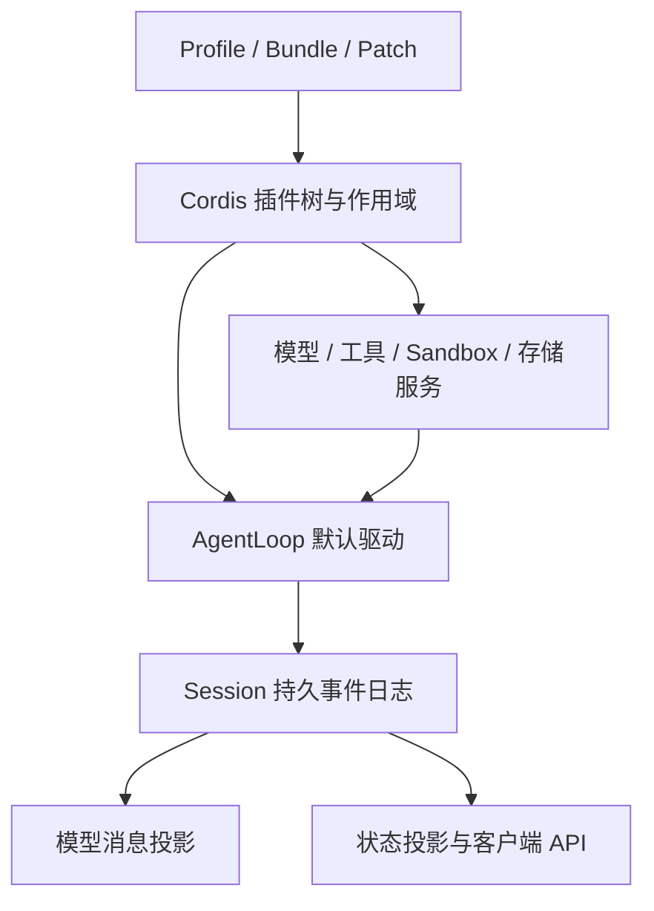
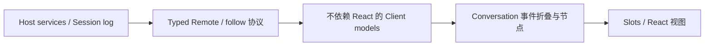
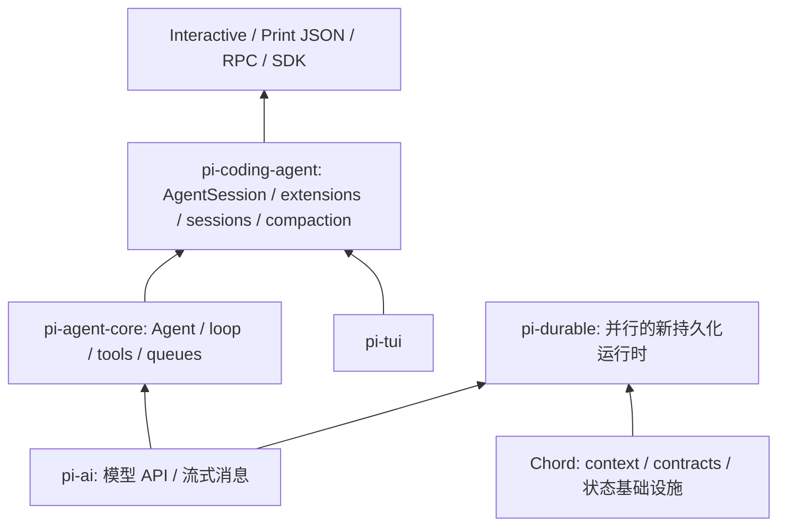

# DeepSeek Harness、Pi 与 lovia：架构比较及可借鉴项

> 调研日期：2026-10-22。状态：研究结论与候选改进，不是已批准的实现计划。
> 方法：官方仓库、官方文档、关键执行路径的静态源码核对；未运行外部项目、未做性能或效果基准。

## 1. 结论

**lovia 的核心方向更接近 Pi 的分层、可嵌入设计；DeepSeek Harness 更适合作为产品运行时与 Web 状态管理的参考。没有必要把 lovia 改造成“万物皆插件”的平台。**

最值得移植的是具体契约：工具恢复时是否允许重放、消息提交去重、工具进度、steer/follow-up 的区分、保留旧结果的会话分支。插件热更新、通用依赖注入容器、完整事件溯源、代码执行运行时，均不应因其他项目具备而直接加入 core。

lovia 已有插件 setup/teardown、provider 抽象、并发工具与串行屏障、steering、上下文压缩、checkpoint、后台子任务、Web 重连和 UI 扩展。它的短板主要在跨层边界的明确语义与可观察性，不能用一张功能数量表判断。[L1][L2][L3]

## 2. 对象、版本与容易混淆的事实

| 对象 | 本报告的固定基线 | 范围 |
| --- | --- | --- |
| DeepSeek Harness（dsh） | `687f282e8625c6b8d11ff58211a90524be2e4317` | 官方 `deepseek-ai/deepseek-harness`，Cordis 驱动的完整 harness 产品 |
| Pi | `be14d9732f98fcc33929cf103a92b96afaa6523e` | 官网当前指向 `earendil-works/pi`，源码中的 CLI/agent-core 与新增 Durable 分开分析 |
| Pi 历史 Web UI | `559a71683d93ac5ff110e89ca0966bdd2a7eeccd` | 仅作历史设计参考；之后的 `b141e1fa2460868686ffd19c5d4ced743eee6c24` 删除了 `packages/web-ui` |
| lovia | `f251dd4563736756f75a833b75e8ba70f8a74ef1`，v0.9.107 | core、workspace、web；不包含当前主工作区的未提交修改 |

Pi 的旧介绍存在三个陷阱：当前已经有 MCP/Codemode；当前仓库已经没有旧 `web-ui` workspace；新增 `pi-durable` 不能被画成当前 coding-agent CLI 的底座。官网对 steering 的“当前工具结束后打断剩余工具”描述，也与本次源码的整轮工具完成后再检查不一致。本报告以固定版本代码为准。[P1][P2][P3][P4]

## 3. DeepSeek Harness：以插件树组成整个产品

### 3.1 Core：插件承载控制流，服务和事件组成扩展面

Cordis 管理插件挂载、服务依赖和可撤销 effect；模型适配器、工具注册表、Session、agent loop 本身都是插件。Profile 叠加 bundle、用户 patch 和命令行 patch，组成运行时插件树；不同 preset 再组合 agent 的能力。它的扩展范围比 lovia 的 `PluginInstance` 广得多。[D1]

关键执行链是：输入入队 → turn 开始 → step 接纳输入、组装 prompt 和工具 → 绑定实际模型请求 → 记录模型可见输入 → 流式生成 → 工具执行管线 → 下一 step 或 turn 结束。DSH 的 **step** 大致对应 lovia 的一次模型调用加工具执行，DSH 的 **turn** 可包含多个 step；比较生命周期时不能仅对齐名称。[D1]

其事件分三类：持久的 Session 事实、运行中的 Agent 事件、能力服务的策略事件。部分事件是必须调用 `next()` 的 waterfall，可以改变执行流程。这与 lovia 的 fail-open 观察 hook 和固定贡献槽不同：后者把控制流留在 `RunLoop`，更容易保持单一执行模型。[D1][L1]

Scope 将注册项的可见性和释放生命周期绑定，子 scope 可继承祖先贡献；销毁后撤销对应注册。它是组合与资源管理机制，不是安全沙箱。lovia 可以继续用 per-run PluginInstance 管理资源，不能把“插件隔离”误理解为限制任意 Python 插件的权限。[D9][L1]

### 3.2 Session 与 compaction：日志不删除，模型视图可由日志重建

DSH 的重要约束是 **model-visible means logged**：模型看到的输入应能从 Session 日志重建。模型历史通过 `deriveMessages()` 投影，改变旧消息的显示或模型表面使用追加的投影/替换事实，而非直接删除日志。压缩也记录其过程及 summary。[D1][D2]

实时 token chunk 与持久记录分开：生成结束后，完整 compact stream 嵌入 assistant message 或失败 attempt；硬崩溃前未 settlement 的过程不因此全部变得持久。Session projection 为 todo、goal、统计等产出 `{asOfSeq, values}`，让状态与同一历史截面一致。[D1][D3]

**适配判断：**借鉴“知道本次请求究竟用了什么”的可追溯性，但保留 lovia 的 canonical transcript + view-only compaction。lovia 的临时 view injector 有明确价值；可按需记录请求视图摘要/指纹，而非强制每次注入都进入用户会话。DSH 的完整日志格式、迁移链、投影系统会增加 lovia 的概念和存储成本。[L1]

两者的“恢复”也不等价：DSH 持久化层文档描述以 synthetic closers 收尾被中断的 turn，不承诺继续原中断 turn 的 partial-turn resume；lovia checkpoint 则会恢复未完成的工具调用。这不构成谁全面更可靠的结论，需要分别看输入接纳、工具副作用与 UI 重连。[D4][L4]

### 3.3 Web：把协议、状态模型、对话投影与渲染拆开

Host 负责权威状态；Client model 负责缓存、订阅、历史窗口和重连；Conversation 层按稳定 ID 折叠事件、生成不同展示目标的节点；React 与 slots 最后渲染。业务插件可贡献自己的对话节点，而不要求 Chat 逐一认识每个插件。[D5][D6]

有价值的是一致性契约：快照基线、generation/sequence、缺口修复、旧连接结果隔离、历史 prepend 与 live update 的确定性归并。`session.prompt` 的 `requestId` 会查找已排队或已记录的同一请求，使一次发送的重试不会再次入队。[D5][D7]

这里确认的是已接纳请求的去重；查重后的附件接纳路径存在异步步骤，本轮未验证所有并发重试的原子性，不把它表述为 exactly-once。lovia 真正实现时应定义原子 reserve 和同键异文冲突规则。[D7]

**适配判断：**lovia 已有 server-owned run、原子的 snapshot + current-turn replay + live tail、有界 subscriber queue；无须为“支持重连”换成 WebSocket。值得补的是请求去重，以及在未来多客户端复杂状态下明确 wire cursor/generation。将对话状态折叠逐步提取为无 DOM 的纯函数，比引入整个 Cordis/React 前端体系更符合当前无构建步骤的 Web。[L2][L5]

### 3.4 Code mode：执行入口变了，治理管线仍保留

DSH 的程序化工具调用模式把模型入口收敛到 `run_code`，生成代码通过 SDK 编排工具；嵌套调用仍经过工具权限、日志和调度约束。这比“开放一个 eval，直接调用 Python 函数”完整得多；子进程默认执行与可选内存驻留也不能等同于崩溃后程序继续执行。[D8]

对 lovia，它最多是一个可选实验 plugin/extra。必须先解决嵌套调用如何复用审批、预算、取消、串行屏障和恢复策略，才能讨论降低工具 schema/token 开销。没有基准，不承诺速度或成本收益。

在代码执行之前还有更小的候选：Pi MCP 将工具暴露区分为 direct、deferred、codemode、hidden，并能按需发现工具。如果 lovia 的多 MCP 服务让工具 schema 占用或启动延迟成为实际瓶颈，可先评测 deferred discovery。目录里可调用的工具不必一次全部塞进 prompt，但仍需验证工具集变化对缓存、审批与恢复的影响。[P10]

## 4. Pi：可嵌入 agent 层，与新的持久化运行时并存

### 4.1 当前 CLI 的分层

`pi-ai` 处理 provider 差异；agent-core 处理模型—工具循环、状态、事件和消息队列；coding-agent 负责 session 文件、压缩、资源加载、扩展与交互模式。`AgentSession` 让 SDK 与 TUI/RPC 共用会话逻辑。与 lovia 相似的部分是 provider 与运行器分离、以结构化接口组合工具、把产品能力留在外层。[P1][P5]

Pi 的扩展不是 DSH 那种替换整个服务树的同一机制：coding-agent extensions 注册工具、事件处理、命令和 UI 行为；它们依附于已有 AgentSession 生命周期。值得借鉴扩展体验与边界清晰度，不必追求两者 API 数量相等。[P6]

### 4.2 双队列：用户纠偏与后续任务具有不同含义

当前 agent loop 先处理 steering，在当前 assistant turn 的工具批次全部结束后再检查；当没有剩余工具工作且没有 steering，才取 follow-up。不是杀掉正在运行的工具，也不是 sequential 模式下每个工具后都检查 steering。[P2]

lovia `Mailbox` 在每次 turn 开始 drain；Web supervisor 会把最终 turn 后剩下的消息接到下一次 run，因此它已经能接受运行中输入。缺口是用户无法明确表示“下一轮纠偏”或“当前任务完成后再做”。`web/followups.py` 是模型建议的问题 chips，与这种 follow-up 队列无关。[L6]

### 4.3 工具：模型内容、UI 信息与程序结果分开

Pi agent-core 的工具结果区分 `content`、`details` 和可选 `structuredContent`；`onUpdate` 回调和 `tool_execution_update` 提供执行过程中的更新。自定义渲染可以用结构化信息，而不是反向解析模型看到的文本。[P3][P6]

lovia 已有 `ToolResultEntry.output/raw/parts`、`result_renderer`，Web 也有 `ui_result`、`put_ui_data`、renderer/tool-view 注册与导出 snapshot。**真实增量首先是进度更新；其次才是结构化 UI 数据更稳定地经过落盘、重连和截断。**不能简单再加一个同义的 `details` 字段。[L3][L7]

### 4.4 Session tree 与压缩

Pi coding-agent 用带 `id/parentId` 的 append-only JSONL entries 表示会话树；活动 leaf 决定上下文路径，切换 leaf 后的追加才形成新分支，分支摘要和 compaction 另记 entries。原记录可保留，不要求覆盖旧回答。[P7]

lovia 的 view-only 压缩已经具有 sticky decisions、checkpoint/session meta 延续、token 校准和工具配对保护。Pi 的 summary/session tree 不能被当成“更先进的压缩算法”直接替换；可借鉴的是历史导航和非破坏分支。[L1]

### 4.5 Pi Durable：最值得研究的是恢复契约

Pi 当前还提供独立的 `pi-durable`：conversation entries、typed documents、task 状态机由原子 commit 关联；输入使用 `requestId` 去重，任务可在重启后恢复。它与 CLI 使用的 agent-core 是不同路径。[P1][P4]

尤其值得借鉴：工具调用 intent 在执行前提交；进程中断后，仅 `replay: "safe"` 的工具自动重跑，否则生成 interrupted error，并保留已经提交的输出。嵌套调用也有自己的重放策略。**即使标记 safe，外部副作用仍需要工具自身提供幂等性；这不是 exactly-once 保证。**[P4]

### 4.6 Web：历史组件库与当前运行时的借鉴应分开

旧 `pi-web-ui` 是基于 Web Components/mini-lit 的可嵌入聊天组件库，包含浏览器侧 Agent、IndexedDB、工具 renderer、artifact 面板与 sandbox；部分只供 UI 使用的消息在送入 LLM 前过滤。这些设计可供参考，但该 workspace 已被删除，不能把它作为当前仍维护的集成依赖。[P8]

lovia 已通过服务端运行 Agent、`put_ui_data`、自定义 renderer/view、sandbox HTML 达成不少相同目标。保留 Python 服务端与浏览器的边界；借鉴可嵌入视图、模型与展示数据分离即可。当前 Pi Durable/Chord 的状态订阅机制提供的是运行时参考，不是现成的 lovia Web UI。[L3][L8][P4][P9]

## 5. 先排除“lovia 已经有”的建议

| 常见建议 | lovia 当前证据 | 真正可以进一步改进的部分 |
| --- | --- | --- |
| 引入插件机制和资源清理 | `Plugin.setup(ctx) → PluginInstance`，LIFO `aclose` | 工具/指令来源诊断，失败可见性 |
| 支持运行中用户输入 | `Mailbox`、inject/uninject、final leftover auto-chain | 显式 follow-up 队列与状态确认 |
| Agent 与 HTTP 连接解绑 | `RunSupervisor` owns task | 消息接纳幂等、队列持久性 |
| 支持断线重连 | 原子快照、当轮事件回放、live tail；overflow 重连 | 必要时增加跨连接游标/代次契约 |
| 工具输出做卡片 | renderer、tool view、HTML export snapshot | 工具执行进度、结构化 payload 的稳定性 |
| 大结果不进模型上下文 | `put_ui_data` + preview；core offload/recall | 生命周期、分支复制、数据丢失回退的统一契约 |
| 可插拔页面和消息操作 | `registerView`、`registerMessageAction`、`provideContext` | 在现有 API 上完成业务实例，避免再建插件平台 |
| 可视化压缩效果 | `context_compacted` 卡片已有前后 tokens、details、summary | 按需显示实际 prompt 组成，而非重复做压缩提示 |

以上以当前源码为准；`docs/design` 中旧方案的“待实现”或“明确不做”不代表当前能力状态。[L1][L2][L3][L5][L6][L7][L9]

## 6. 建议排序：具体改哪里，为什么，怎样验收

这里的 P1/P2 是产品投入顺序，**不是已复现故障的严重等级**。规模是相对估计，不是工期承诺。

| 顺序 | 候选 | 层 | 来源 | 价值 / 规模 |
| --- | --- | --- | --- | --- |
| P1 | 工具恢复重放策略 | core | Pi Durable | 有副作用工具的恢复边界更明确 / 中 |
| P1 | 消息提交去重与接纳状态 | web | DSH、Pi Durable | 处理确认丢失后的重发 / 中 |
| P1 | 工具进度事件与卡片更新 | core + web | Pi agent-core | 长任务可见、减少“卡住”感 / 中 |
| P2 | steer/follow-up 区分 | core + web | Pi、DSH inbox | 明确运行中发送的意图 / 中 |
| P2 | 非破坏分支 | web + store | Pi tree、DSH fork | 保留编辑/重试前的答案 / 中 |
| P2 | 运行时诊断页 | web，复用 core hook | DSH 运行时检查、Pi SDK 状态接口 | 解释本轮能力与上下文 / 小起步 |
| 条件性 | 结构化 UI payload 与协议演进 | web 为主 | Pi result、DSH client contracts | 解决已出现的截断/恢复问题时做 / 中 |
| 实验性 | code mode | optional plugin/extra | 两者 | 工具多、批处理需求明确时评测 / 大 |

### 6.1 工具恢复重放策略

**现状与动机。** `RunLoop._drain_pending_calls()` 会重新执行没有配对 result 的调用；checkpoint 在结果后保存。若外部副作用已发生，但结果尚未写入 checkpoint，恢复时无法从本地记录判断副作用是否发生。这个窗口来自静态执行路径分析，并非本次故障注入复现。[L4]

**最小方案。** 在既有 `Tool` 策略附近定义可选 replay policy；首版保留未声明工具的现有行为并明确文档，允许副作用工具显式选择“禁止自动重放”。无结果时产出配对的 interrupted/uncertain 结果或交给调用方恢复，不能悄悄当成成功。提供持久稳定的 invocation identity 给下游幂等 API；不能只用 provider `call_id`，因为 lovia 当前允许重复 ID 并按 occurrence 配对。[L4]

不改变已有 retry 的含义：普通执行异常重试与进程崩溃后的重放是不同决策。默认行为变更另行评估兼容性，不能借调研悄然改变旧 API。

“没有 result”也可能代表尚未开始执行；若首版没有持久 dispatch 状态，对禁止重放工具一律标记 uncertain 是保守选择，会牺牲部分自动恢复率，不能假称已经知道该调用执行过。

**验收。** 对“副作用已发生、checkpoint 保存前崩溃”注入失败；分别验证 safe/unsafe 策略、重复 provider call ID、并发工具、handoff、审批和恢复后 call/result 配对。只能保证框架遵守重放策略，外部 exactly-once 仍取决于下游幂等支持。

### 6.2 消息提交去重与接纳状态

**现状。** Web `ChatRequest`/`InjectRequest` 没有请求幂等键；checkpoint 的 `run_id` 去重发生在另一层，不能阻止同一 HTTP 消息被再次注入。[L10]

**最小方案。** 浏览器为一次发送生成稳定 request ID，重试沿用；Web admission 按身份/会话和 request ID 去重，返回原接纳结果与状态。首次创建会话时也要能从该键找回 session，不能只对已有 session 生效。同键不同 payload 应拒绝，不能默默返回不相关结果。若承诺跨重启去重，接纳记录与待消费消息必须持久地关联；仅内存字典应明确只覆盖当前进程。

**验收。** 服务端接受后响应丢失再重试，只出现一次输入；两标签同时重试、带附件、运行中排队、删除会话、同键异文、重启后的状态都有明确行为。UI 显示“已接纳/待执行/已消费/失败”，而不是把网络成功误当成执行完成。

### 6.3 工具进度

在现有执行队列增加按 invocation 关联的 progress 事件，由单一 loop dispatch 点送到 hooks 和 Web；最终 result 仍然独立且只产生一次。进度不作为新的模型消息不断追加，不把局部结果当成终态。[L4][P3]

Web 沿用现有 tool card/renderers，做节流、容量上限、终态覆盖，重连至少恢复最后一个进度快照。并发调用和工具重试必须能区分 attempt，避免旧更新覆盖新的状态。若同步工具在线程运行，进度入口需要明确跨线程转发约束。验收覆盖慢订阅者、取消、重连、失败、迟到事件和重复 update。

### 6.4 steer/follow-up

保留现有 turn 边界注入契约；让调用方选择“下一模型轮次看到”或“当前任务完成后再开始”。可先在 Web supervisor 提供 follow-up queue，验证需求后再决定是否推广为 core 公共接口，不必马上扩大 `Mailbox`。[L6]

UI 提供明确的发送方式、等待队列、撤回/编辑与已消费反馈；进程重启前后的队列保证跟随 6.2 的 admission 设计。不要照搬 Pi 官网页面里已滞后的“立即打断工具”描述。验收要覆盖最终 assistant turn 到来的消息、取消与失败时未消费消息的归属。

同时区分“消息已接纳”“本次 run 完成”“队列耗尽、会话暂时空闲”。Pi RPC 的 accepted 与 `agent_settled` 区分可作参考；lovia 的结束通知、发送按钮和自动接续也应使用适合的状态，而不必增加一套 stdio RPC 服务。[P11][L6]

### 6.5 非破坏分支

lovia Web 当前 `/rewind` 是编辑重发/重新生成背后的破坏性回退；它要求没有活跃运行，并会移除目标消息及后续内容。Core `Session` 的 append-only 契约与这个 Web/store 特定能力必须区分。[L11]

最小实现是在某个稳定消息 ref 创建新 session，复制合法前缀并记录来源；先只支持 user-turn 边界，保持工具配对。core 继续消费线性 transcript，不增加 `Session.replace`，也不急着把整个 store 改为 DAG。

分支元数据不要直接复用现有表示 subagent 归属的 `parent_id`；附件、UI data refs、compaction meta 和 workspace 共享方式均需有定义。会话分支不等于文件系统回滚，UI 必须让用户知道工作区状态是否共享。验收包括原会话删除后分支是否仍完整、分支间 UI 数据隔离，以及活动运行期间拒绝或等待的行为。

### 6.6 诊断与协议：先证明需要，再扩大抽象

用现有 hook、tracer、`ctx.system_prompt`、`registerView` 先做一个示例诊断页：列出实际激活的 provider/tools/plugins、能力来源、上下文估计与已应用的 compaction 决策。lovia 已有日志、span、token 统计和压缩卡片；改进目标是把它们按同一次 run 关联起来。敏感 prompt 和工具结果不能默认对所有页面公开。[L9][L12]

这只是基础诊断：`ctx.system_prompt` 是 leading system text，现有 hooks 不直接提供 compaction、injector 和最终 provider route 处理后的完整请求。如果要回答“某次 attempt 的模型实际看到了什么”，需要额外的窄 request observer 或 provider wrapper；仅记录指纹只能检测变化，不能重建输入。[L1][L12]

结构化 UI 数据也先复用 `raw/output/parts` 和 data refs。现有 `ui_result` 是字符串 envelope，会被输出截断破坏 JSON；若这一问题在实际工具中频繁出现，再设计有界、可序列化、可版本化的 UI metadata 通道，并覆盖落盘、重连、导出和旧客户端降级，避免重复造一个 ToolResult。[L3][L7]

协议可先增加 representative payload fixtures，核对 Python TypedDict、前端类型和重连 reducer 的一致性。当前 `test_protocol.py` 已检查事件注册表与文档，不要把它误说成“完全没有协议测试”。只有出现独立发布客户端/多端同步需求，再考虑 wire version、cursor 和 schema 生成。[L5]

## 7. 不建议照搬

- **把 loop、Session、scheduler、UI 全改成插件服务。** DSH 的目标是可重组产品平台；lovia 的固定 loop + Protocol/plugin 槽位更符合简洁与轻依赖要求。
- **把全部内部状态改成 event sourcing 或 durable task 图。** 会增加事务、迁移、重放、版本与诊断负担。先引入明确的工具恢复策略和请求幂等。
- **用 Pi 的权限取舍替换 lovia 的边界。** 当前 Pi CLI 默认依赖宿主权限/外部隔离；lovia 已有 workspace policy、审批与 ShellExecutor seam，应继续保持。[P1][L1]
- **为了 Web 扩展换 React、引入构建工具，或恢复旧 pi-web-ui。** lovia 已有稳定的公开 JS 扩展面；需要具体业务证明当前接口不足。
- **强制 DSH 的模型可见内容全部入会话日志。** 可以加 opt-in 调试记录，但不要破坏 lovia view-only compaction、临时注入和 prompt cache 不变量。
- **默认开放 code mode 或运行中插件热替换。** 两者都扩大执行和生命周期边界；只有独立实验、明确需求、可测收益时才值得承担。

## 8. 推荐落地顺序与研究边界

先单独设计工具 replay policy 与 Web admission 幂等，两项互不替代；随后做工具进度。再基于输入 admission 设计双队列，基于现有 store 设计非破坏分支。诊断页从 example 开始；code mode 留到有任务集可测时。

本轮只产出调研文档，不修改 core/web 行为、不升级版本。建议的效果与成本尚未经压测；跨重启消息接纳、工具重放和 UI 事件恢复是三个不同保证，不能用“支持持久化”一笔带过。后续设计必须分别列出事务边界、兼容策略和故障注入验收。

## 9. 一手资料索引

以下外部源码链接固定到本次提交；lovia 链接同样固定，避免后续行号变化影响结论。

- [D1]：DSH 官方架构、事件域与 turn/step 执行链。
- [D2]：DSH compaction 与 surface 变更。
- [D3]：DSH 状态投影与 asOfSeq。
- [D4]：DSH 持久化边界及 synthetic closers。
- [D5]：DSH Web Client 分层和同步协议。
- [D6]：DSH Conversation 节点与确定性事件归约。
- [D7]：DSH prompt admission；同文件 L584-L595 为查重实现。
- [D8]：DSH PTC 子调用管线；运行时限制另见下方。
- [D9]：DSH scope 的生命周期与非安全隔离边界。
- [P1]：Pi 当前包分层与权限模型。
- [P2]：Pi steering/follow-up 消费顺序。
- [P3]：Pi 工具结果三通道与 onUpdate。
- [P4]：Pi Durable commit/task/document、请求去重与工具 replay。
- [P5]：Pi AgentSession 与 SDK 生命周期。
- [P6]：Pi coding-agent extension 与工具渲染。
- [P7]：Pi append-only session tree 与 compaction entries。
- [P8]：Pi 已删除的历史 web-ui。
- [P9]：Chord host、contract、状态与生命周期。
- [P10]：Pi 当前 MCP 与工具 exposure/Codemode。
- [P11]：Pi RPC admission 与 agent_settled。
- [L1]：lovia 分层、插件、压缩与持久化不变量。
- [L2]：lovia EventHub 与原子 attach。
- [L3]：lovia UI envelope、旁路数据与截断边界。
- [L4]：lovia 恢复未完成调用；同文件 _drain_batch 与 pending_tool_calls。
- [L5]：lovia SSE 协议注册表；参见 tests/web/test_protocol.py。
- [L6]：lovia Mailbox；Web auto-chain 另见下方 supervisor。
- [L7]：lovia ToolResultEntry；输出保留上限另见 tool_calls.py。
- [L8]：lovia Web 公开扩展 API。
- [L9]：lovia 现有 compaction 展示。
- [L10]：lovia ChatRequest/InjectRequest。
- [L11]：lovia Web rewind。
- [L12]：lovia hooks、tracing 与 logging。

补充核对链接：

- [DSH requestId 与 queue/steer 类型](https://github.com/deepseek-ai/deepseek-harness/blob/687f282e8625c6b8d11ff58211a90524be2e4317/packages/api/session-controller/src/types.ts#L343-L350)。
- [DSH rpcId 写入 source](https://github.com/deepseek-ai/deepseek-harness/blob/687f282e8625c6b8d11ff58211a90524be2e4317/packages/api/session-controller/src/index.ts#L477-L485)。
- [DSH pending/durable 查重实现](https://github.com/deepseek-ai/deepseek-harness/blob/687f282e8625c6b8d11ff58211a90524be2e4317/packages/api/session-controller/src/commands.ts#L584-L595)。
- [DSH Node PTC runtime 与持久性限制](https://github.com/deepseek-ai/deepseek-harness/blob/687f282e8625c6b8d11ff58211a90524be2e4317/packages/ptc-runtime/ptc-runtime-node/README.md)。
- [Pi CLI 依赖 agent-core，未依赖 Durable](https://github.com/earendil-works/pi/blob/be14d9732f98fcc33929cf103a92b96afaa6523e/packages/coding-agent/package.json)。
- [Pi 删除 web-ui 的提交](https://github.com/earendil-works/pi/commit/b141e1fa2460868686ffd19c5d4ced743eee6c24)。
- [Pi compaction](https://github.com/earendil-works/pi/blob/be14d9732f98fcc33929cf103a92b96afaa6523e/packages/coding-agent/docs/compaction.md)。
- [Pi branch 移动 leaf、branchWithSummary 追加摘要](https://github.com/earendil-works/pi/blob/be14d9732f98fcc33929cf103a92b96afaa6523e/packages/coding-agent/src/core/session-manager.ts#L1573-L1625)。
- [lovia final leftover auto-chain](https://github.com/cymoo/lovia/blob/f251dd4563736756f75a833b75e8ba70f8a74ef1/lovia/web/supervisor.py#L672-L683)。
- [lovia tool completion 后保存 checkpoint](https://github.com/cymoo/lovia/blob/f251dd4563736756f75a833b75e8ba70f8a74ef1/lovia/runtime/loop.py#L1125-L1163)。
- [lovia 重复 tool call ID 的 occurrence 配对](https://github.com/cymoo/lovia/blob/f251dd4563736756f75a833b75e8ba70f8a74ef1/lovia/runtime/loop.py#L1697-L1716)。
- [lovia raw/output 保留与截断](https://github.com/cymoo/lovia/blob/f251dd4563736756f75a833b75e8ba70f8a74ef1/lovia/runtime/tool_calls.py#L407-L449)。
- [lovia system_prompt 只表示 leading system text](https://github.com/cymoo/lovia/blob/f251dd4563736756f75a833b75e8ba70f8a74ef1/lovia/run_context.py#L135-L148)。
- [lovia 现有协议测试](https://github.com/cymoo/lovia/blob/f251dd4563736756f75a833b75e8ba70f8a74ef1/tests/web/test_protocol.py)。
- [lovia HTML sandbox frames](https://github.com/cymoo/lovia/blob/f251dd4563736756f75a833b75e8ba70f8a74ef1/lovia/web/static/js/sandbox.js)。
- [lovia 工具卡片扩展与导出](https://github.com/cymoo/lovia/blob/f251dd4563736756f75a833b75e8ba70f8a74ef1/lovia/web/static/js/tool-views.js)。
- [lovia renderer cleanup 与数据回退](https://github.com/cymoo/lovia/blob/f251dd4563736756f75a833b75e8ba70f8a74ef1/lovia/web/static/js/components.js)。

[D1]: https://github.com/deepseek-ai/deepseek-harness/blob/687f282e8625c6b8d11ff58211a90524be2e4317/docs/architecture.md
[D2]: https://github.com/deepseek-ai/deepseek-harness/blob/687f282e8625c6b8d11ff58211a90524be2e4317/docs/subsystems/compaction.md
[D3]: https://github.com/deepseek-ai/deepseek-harness/blob/687f282e8625c6b8d11ff58211a90524be2e4317/packages/session/session-projection/README.md
[D4]: https://github.com/deepseek-ai/deepseek-harness/blob/687f282e8625c6b8d11ff58211a90524be2e4317/packages/session/session-persistence/README.md
[D5]: https://github.com/deepseek-ai/deepseek-harness/blob/687f282e8625c6b8d11ff58211a90524be2e4317/docs/subsystems/web-client.md
[D6]: https://github.com/deepseek-ai/deepseek-harness/blob/687f282e8625c6b8d11ff58211a90524be2e4317/docs/subsystems/conversation.md
[D7]: https://github.com/deepseek-ai/deepseek-harness/blob/687f282e8625c6b8d11ff58211a90524be2e4317/packages/api/session-controller/src/commands.ts#L319-L352
[D8]: https://github.com/deepseek-ai/deepseek-harness/blob/687f282e8625c6b8d11ff58211a90524be2e4317/packages/core/tools/src/ptc.ts#L542-L627
[D9]: https://github.com/deepseek-ai/deepseek-harness/blob/687f282e8625c6b8d11ff58211a90524be2e4317/packages/core/scope/README.md
[P1]: https://github.com/earendil-works/pi/blob/be14d9732f98fcc33929cf103a92b96afaa6523e/README.md
[P2]: https://github.com/earendil-works/pi/blob/be14d9732f98fcc33929cf103a92b96afaa6523e/packages/agent/src/agent-loop.ts#L175-L325
[P3]: https://github.com/earendil-works/pi/blob/be14d9732f98fcc33929cf103a92b96afaa6523e/packages/agent/src/types.ts#L424-L488
[P4]: https://github.com/earendil-works/pi/blob/be14d9732f98fcc33929cf103a92b96afaa6523e/packages/durable/README.md
[P5]: https://github.com/earendil-works/pi/blob/be14d9732f98fcc33929cf103a92b96afaa6523e/packages/coding-agent/docs/sdk.md
[P6]: https://github.com/earendil-works/pi/blob/be14d9732f98fcc33929cf103a92b96afaa6523e/packages/coding-agent/docs/extensions.md
[P7]: https://github.com/earendil-works/pi/blob/be14d9732f98fcc33929cf103a92b96afaa6523e/packages/coding-agent/docs/session-format.md
[P8]: https://github.com/earendil-works/pi/blob/559a71683d93ac5ff110e89ca0966bdd2a7eeccd/packages/web-ui/README.md
[P9]: https://github.com/earendil-works/pi/blob/be14d9732f98fcc33929cf103a92b96afaa6523e/packages/chord/README.md
[P10]: https://github.com/earendil-works/pi/blob/be14d9732f98fcc33929cf103a92b96afaa6523e/packages/coding-agent/docs/mcp.md
[P11]: https://github.com/earendil-works/pi/blob/be14d9732f98fcc33929cf103a92b96afaa6523e/packages/coding-agent/docs/rpc.md
[L1]: https://github.com/cymoo/lovia/blob/f251dd4563736756f75a833b75e8ba70f8a74ef1/docs/architecture.md
[L2]: https://github.com/cymoo/lovia/blob/f251dd4563736756f75a833b75e8ba70f8a74ef1/lovia/web/supervisor.py#L147-L388
[L3]: https://github.com/cymoo/lovia/blob/f251dd4563736756f75a833b75e8ba70f8a74ef1/lovia/web/components.py
[L4]: https://github.com/cymoo/lovia/blob/f251dd4563736756f75a833b75e8ba70f8a74ef1/lovia/runtime/loop.py#L774-L816
[L5]: https://github.com/cymoo/lovia/blob/f251dd4563736756f75a833b75e8ba70f8a74ef1/lovia/web/sse.py
[L6]: https://github.com/cymoo/lovia/blob/f251dd4563736756f75a833b75e8ba70f8a74ef1/lovia/steering.py
[L7]: https://github.com/cymoo/lovia/blob/f251dd4563736756f75a833b75e8ba70f8a74ef1/lovia/transcript.py#L109-L135
[L8]: https://github.com/cymoo/lovia/blob/f251dd4563736756f75a833b75e8ba70f8a74ef1/lovia/web/static/js/lovia.js#L105-L159
[L9]: https://github.com/cymoo/lovia/blob/f251dd4563736756f75a833b75e8ba70f8a74ef1/lovia/web/static/js/chat.js#L1296-L1365
[L10]: https://github.com/cymoo/lovia/blob/f251dd4563736756f75a833b75e8ba70f8a74ef1/lovia/web/schemas.py#L158-L190
[L11]: https://github.com/cymoo/lovia/blob/f251dd4563736756f75a833b75e8ba70f8a74ef1/lovia/web/api/sessions.py#L338-L425
[L12]: https://github.com/cymoo/lovia/blob/f251dd4563736756f75a833b75e8ba70f8a74ef1/docs/en/observability.md
